  

  🕷️ A literal crawler reading this profile — inspired by <a href="https://github.com/lulu38m/spider-crawler">spider-crawler</a>

### Featured projects

- **[seeUtoken](https://github.com/Alver-Lin/seeUtoken)** — lightweight desktop tool for Cursor / Codex token usage & remaining quota
- **[AgenttestGuide](https://github.com/Alver-Lin/AgenttestGuide)** — how to test agents
- **[Database-Compare](https://github.com/Alver-Lin/Database-Compare)** — structure & field diff helper for migration verification
- **[EchoPlayer](https://github.com/Alver-Lin/EchoPlayer)** — train listening / pronunciation with real movies & shows

### Interact

Want the spider to crawl a live page? → [alver-lin.github.io/spider](https://alver-lin.github.io/spider/)
